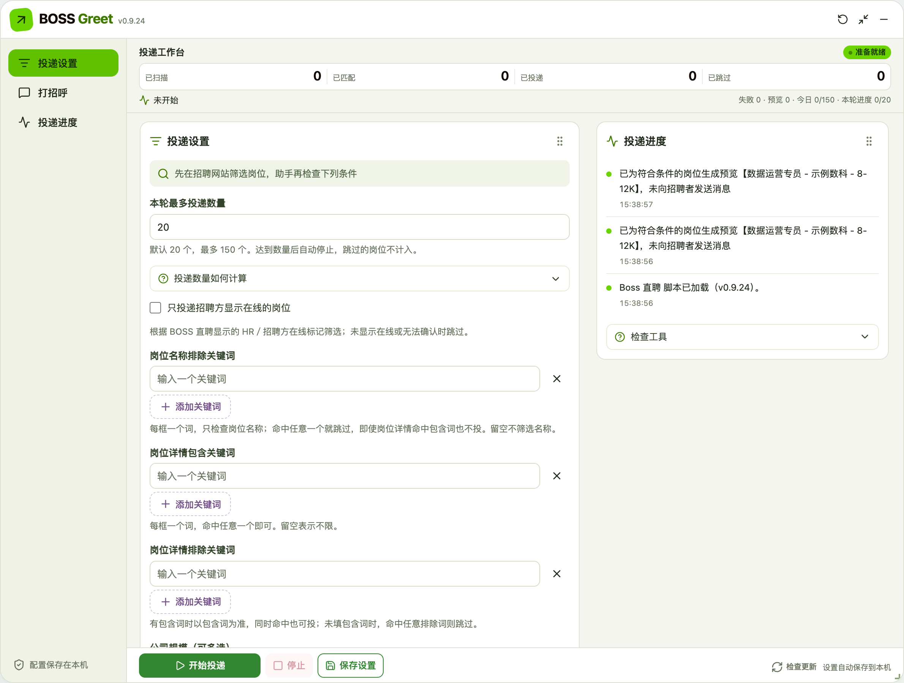
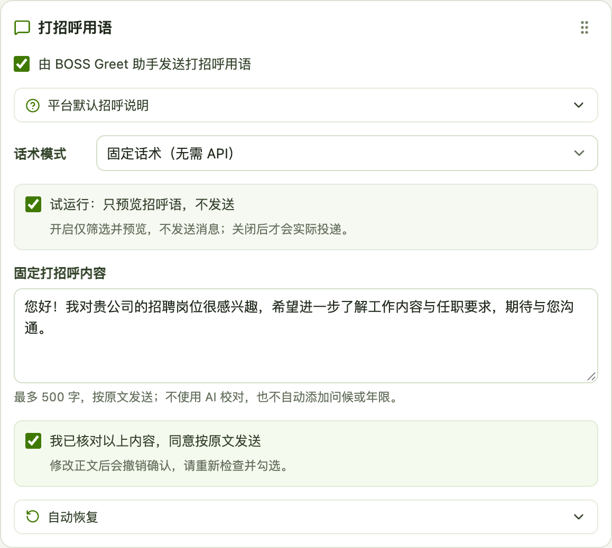
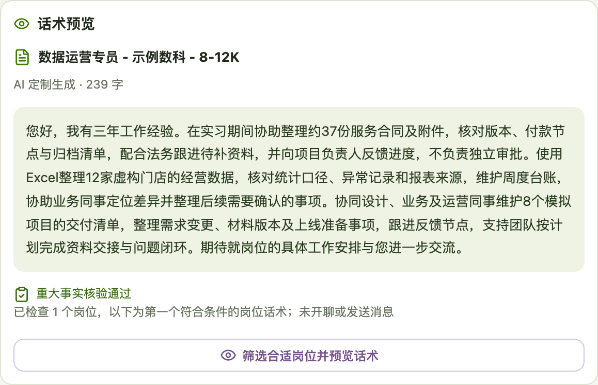

# BOSS Greet

专注于 **BOSS 直聘网页端**的求职投递助手，可筛选岗位、控制投递数量、发送固定或 AI 定制招呼。

**适用范围：下列功能介绍与安装步骤均以 BOSS 直聘为主。猎聘、智联招聘、前程无忧和实习僧仅保留部分基础适配，功能不完整，未完成与 BOSS 同等范围的验证，暂不建议用于这些平台。**

当前版本：`0.9.23`。 [安装助手](https://raw.githubusercontent.com/iruriQ/BOSS-Greet/main/boss-auto-apply.user.js) · [最新版下载](https://github.com/iruriQ/BOSS-Greet/releases/latest)

## 有哪些功能

| 功能 | 怎么用 |
| --- | --- |
| 岗位筛选 | 按关键词、公司规模、距家距离、招聘方在线及活跃度筛选 |
| 控制数量 | 本轮最多投 1—150 个，达到数量自动停止 |
| 固定话术 | 填写并确认一段招呼，按原文发送，无需 AI API |
| AI 定制 | 按真实经历生成，目标 300 字时至少 200 字，可补简历亮点并核验重大事实 |
| 简历资料 | 上传或粘贴文本，也可读取本人 BOSS 在线简历，核对后使用 |
| 话术预览 | 先筛出合适岗位，再预览招呼；预览不开聊、不发送 |
| 投递进度 | 查看扫描、匹配、投递和跳过数量，以及处理原因 |
| 避免重复 | 保留去重记录；助手发招呼前关闭并复查 BOSS 自动招呼 |
| 窗口调整 | 拖动标题移动，拖动边缘缩放；工作台与操作按钮固定 |
| 版本提醒 | 显示新版本及更新内容，可更新或继续使用当前版本 |

## 看图了解

**① 投递设置：关键词独立填写、公司规模多选、自定本轮数量。**

**② 固定话术：填好正文并勾选确认即可，不用配置 AI。**

**③ AI 话术预览：按岗位生成，重大事实核验通过后展示。**

截图均使用虚构岗位、经历和模拟模型回复，未向真实招聘者发送消息。

## 新手安装（电脑端）

需要电脑端 **Chrome 或 Edge + 篡改猴**。不用编程，不需要 Node.js、Python 或服务器，也无需 GitHub 账号。

1. 打开 [篡改猴官网](https://www.tampermonkey.net/)，选择自己的浏览器，在官方扩展商店安装。
2. 右键篡改猴图标 →「管理扩展程序」→ 开启「允许用户脚本」。没有此项时按 [官方说明](https://www.tampermonkey.net/faq.php?locale=zh&q=Q209) 开启开发者模式。
3. 点击 [安装助手](https://raw.githubusercontent.com/iruriQ/BOSS-Greet/main/boss-auto-apply.user.js)，在篡改猴页面点「安装」。若只显示代码，到篡改猴「管理面板 → 实用工具 → 从 URL 安装」粘贴该链接安装。
4. 登录 [BOSS 职位列表](https://www.zhipin.com/web/geek/job)并刷新。设置条件和数量、填写招呼并确认，先预览；实际投递时取消「试运行：只预览招呼语，不发送」，再点「开始投递」。

**AI 与网络：** 固定话术和筛选无需 API；AI 定制需自己的接口、模型和密钥。VPN 并非必需，取决于能否访问扩展商店、GitHub 及自选 AI 接口。安装后固定模式只需招聘网站可访问。

**资料与使用：** 公开版不含私人简历或密钥；资料保存在本机，AI 模式会发送相关资料到你配置的服务。保持网页打开，只启用一份助手；遇登录异常或验证会暂停，不保证避免平台限制。

[详细使用与常见问题](docs/usage.md) · [开发与发布](docs/development.md) · [历史更新](https://github.com/iruriQ/BOSS-Greet/releases)

基于 [ultraplan-bit/boss-auto-apply](https://github.com/ultraplan-bit/boss-auto-apply) 和 [muyuniao/boss-auto-apply](https://github.com/muyuniao/boss-auto-apply) 修改，采用 [MIT 许可](LICENSE)。
